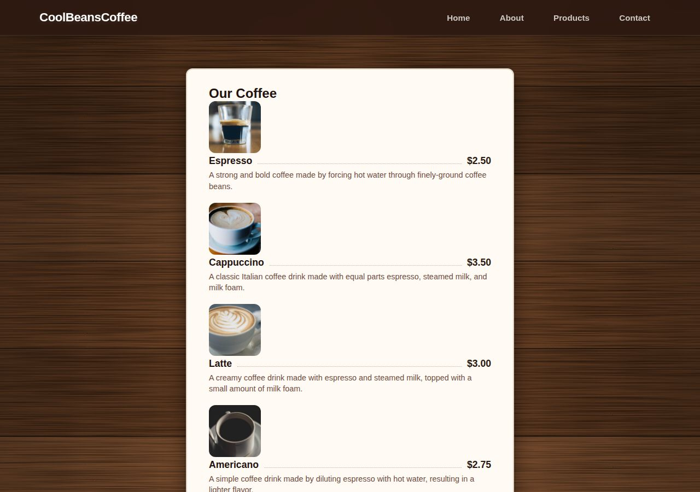

# CoolBeansCoffee

A menu website for a made-up coffee shop, built as a practice project with plain HTML and CSS plus a little JavaScript. No frameworks, no build step.

**Live site:** [cader69.github.io/Programmer-2026/CoolBeansCoffee](https://cader69.github.io/Programmer-2026/CoolBeansCoffee/)



## What's on the page

- **A menu of ten coffees**, each with a photo, a price and a short description, from a $2.50 espresso to a $4.50 affogato.
- **About, Hours, Contact and Location cards**, two per row on wide screens and one per row on phones.
- **A frosted-glass header** that stays at the top, with links that glide to each section.
- **Privacy Policy and Terms and Conditions pages**, linked from the footer.
- **A cookie banner** that remembers the visitor's choice. It's written but not switched on yet (see [What's next](#whats-next)).

## How it's built

- **The wooden table is all CSS.** The `<style>` block in `index.html` stacks four background layers: a dark vignette at the edges, thin seams between planks, slightly different shades from plank to plank, and SVG noise stretched sideways into wood grain. There's no image file.
- **Dotted lines join each name to its price.** `.item-info::after` is an empty flex item with `flex: 1` and a dotted bottom border, so it stretches across the gap. `order: 2` on the price moves the price after the line.
- **The info cards rearrange without a media query.** `grid-template-columns: repeat(auto-fit, minmax(min(320px, 100%), 1fr))` fits two cards per row when there's room and one when there isn't.
- **The header stays put without hiding anything.** `position: sticky` keeps the header's own space in the page, where a `fixed` header would sit on top of the menu. `scroll-padding-top` makes nav jumps land just below it.
- **It's light.** No frameworks and no web fonts. The page, the stylesheet and all ten photos add up to about 225 KB.

## Accessibility

- Every photo has alt text.
- Menu text on the cream card has a 17.6:1 contrast ratio, and the lighter descriptions reach 7.3:1. Both clear the 7:1 that WCAG AAA asks for.
- A 3px cream focus ring shows keyboard users where they are, on the dark header and on the wood.
- If a visitor's device asks for reduced motion, smooth scrolling and transitions turn off.
- With very large text, nav links, prices and long words wrap to the next line instead of running off screen.
- On short screens (landscape phones, or a browser zoomed to 200-400%) the header scrolls away instead of covering a big slice of the window.
- Footer links are at least 24px tall, so they're easy to tap.

## Run it locally

There's nothing to install. Clone the repo and go to this folder:

```bash
git clone https://github.com/CadeR69/Programmer-2026.git
cd Programmer-2026/CoolBeansCoffee
```

Then open `index.html` in a browser. To test it on a local web server instead, run:

```bash
python3 -m http.server 8000
```

and visit http://localhost:8000.

## Project structure

```text
CoolBeansCoffee/
├── index.html                 the page: menu, info cards, cookie banner, footer, wood background
├── stylesheetone.css          menu card, header, info grid, phone and accessibility rules
├── script.js                  cookie banner: shows it until the visitor picks, then remembers
├── privacy-policy.html
├── terms-and-conditions.html
├── CREDITS.md                 source, license and photographer for every photo
├── screenshot.jpg             the picture at the top of this README
└── images/                    the ten menu photos, 400x400 each
```

## Credits

All ten menu photos are CC0 (public domain), from StockSnap, rawpixel and Wikimedia Commons. [CREDITS.md](CREDITS.md) lists the source page, the license and, where known, the photographer for each one.

The shop is fictional. Its address, phone number and email are placeholders.

## What's next

- [ ] Load `script.js` from `index.html` so the cookie banner shows up.
- [ ] Highlight the nav link for the section on screen. The `.active` style is already in the CSS, but nothing sets it yet.
- [ ] Rewrite the privacy policy for this site. It's a template that mentions orders, payments and subscriptions the site doesn't have, and CREDITS.md doesn't record where it came from.
